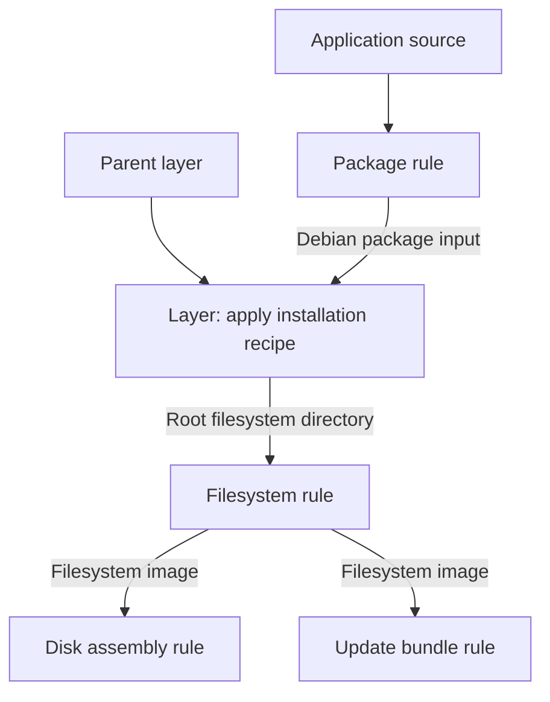

Rugix Bakery builds a system in two stages: prepare its filesystem, then turn
that filesystem into release artifacts. Layers and recipes describe the
filesystem. Build rules describe artifact transformations and connect them into
a pipeline. Tooling environments provide additional programs when a rule needs
them.

A project can use Bakery's predefined image pipelines or supply its own pipeline
through a repository. Both use the same build engine, and both can reuse existing
layers and recipes.

## Systems, Layers, and Recipes

A **project** contains configuration for one or more **systems**. A system selects
a target CPU architecture, a layer, and an image pipeline. For example, a project
can define separate systems for a Raspberry Pi device and an EFI virtual machine
while sharing application configuration.

A **layer** is a filesystem and its associated build outputs. It usually starts
from a parent layer, then applies a set of **recipes** to add packages, install
an application, or configure services. A root layer can bootstrap a distribution
or import an existing image. Layers include a root filesystem and can also
contain boot files, configuration, board support files, and additional artifacts.

:::note
If you are coming from Yocto, note that Bakery layers contain build outputs,
while Yocto layers contain build metadata and configuration.
:::

A recipe contains ordered **steps**. Run steps execute in Bakery with access to
the layer's directories. Install steps execute inside the target root filesystem.
Recipes can declare parameters and file or directory inputs. An input can be
supplied by the project or produced by a build rule before the recipe runs.

Bakery caches completed layers, so systems with a shared parent reuse the same
base filesystem.

## Rules and Artifacts

An **artifact** is a file or directory passed between build operations. For
example, a root filesystem directory, a kernel, a filesystem image, and an update
bundle are all artifacts.

A **rule** defines a reusable operation with named inputs, parameters, and
outputs. Invoking a rule creates a **node** in the build graph. Binding an input
to another node's output creates a dependency: Bakery must produce that output
before running its consumer.

A rule can run a command, build a layer, or compose other rule invocations.
A composition exposes its own inputs and outputs, so projects can reuse an
entire pipeline in the same way as an individual operation. Node names belong
to that composition; they are separate from rule names and input names.

For example, an application package can be built before a recipe installs it
into a layer. That layer can then supply an image pipeline:

Layer builds and artifact operations run in the same dependency graph. Bakery
executes the nodes needed for the requested outputs and reuses cached outputs
when their tracked inputs and implementation are unchanged. A recipe can define
a default rule invocation for an input; supplying a prebuilt artifact instead
skips that invocation.

## Tooling Environments

An **environment** defines build tooling with a Dockerfile and its build context
in `envs/<name>/`. Bakery builds and caches the container image. A rule can
select an environment to run its command in a fresh container, for example to
compile an application or sign a boot artifact.

Rules without an environment run with the tools in Bakery's container. Core
rules use this mode. Recipe steps continue to run in Bakery or inside the target
root filesystem.

An environment supplies the tools used by a command. Artifact bindings supply
the data and dependencies between commands. Multiple rules can share one
environment without sharing changes to its container filesystem.

## Image Pipelines

A system with a `target` uses Bakery's predefined pipeline for that boot flow.
Bakery builds its layer, prepares boot files, creates filesystems, assembles the
disk, and can produce a Rugix Ctrl update bundle. The pipeline uses reusable core
rules internally.

A system with `build.uses` selects a repository rule as its pipeline. Bakery
still builds the layer and prepares release metadata, then supplies the layer's
artifacts to that rule. The selected rule controls the resulting image and any
additional outputs, including an optional update bundle. It can compose the
same core rules with device-specific operations.

For example, two device variants can share a Debian parent and an application
layer, then add separate device layers and image pipelines. Bakery reuses the
common layers while each pipeline chooses its own boot packaging and layout.
See [systems](/docs/bakery/next/systems#repository-build-rules) for a complete configuration
example.

## Repositories

A **repository** distributes reusable layers, recipes, rules, and environments.
Projects can use definitions from local directories or Git repositories. The
built-in `core` repository supplies standard base layers, customization recipes,
and artifact rules.

Names such as `core/image-ext4` identify a definition in a repository.
Unprefixed names identify definitions in the repository containing the reference.
This lets a repository package a pipeline together with its tooling and other
dependencies.

Continue with [projects](/docs/bakery/next/projects) to configure a build, or browse the
[core reference](/docs/bakery/next/reference/core/) and
[configuration schemas](/docs/bakery/next/reference/schemas).
