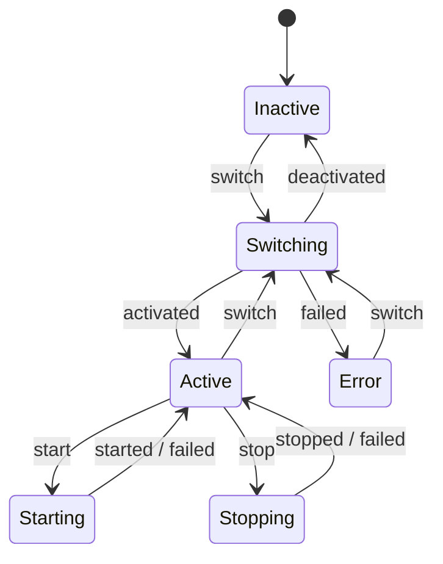
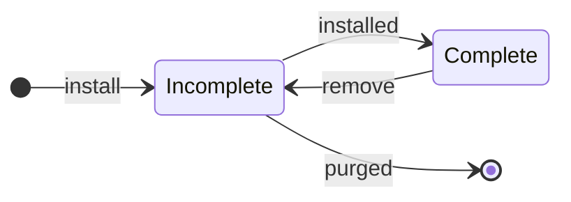

This page documents the technical internals of Rugix Apps: app and generation state machines, storage layout, bundle format, app manifest, format versions, stored files, systemd integration, crash recovery, and the CLI reference. For an introduction, start with [Application Management](../).

## App State Machine

An app is always in one of the following states:



Activation, deactivation, generation switches, and configuration changes are all represented by the `Switching` state. Its `from` and `to` values are deployment pairs consisting of a generation and an optional device-specific configuration revision. The `from` deployment is deactivated first, then the `to` deployment is activated. If activation fails and a `from` deployment is available, rollback to that exact pair is attempted automatically. If rollback also fails, the app enters the `Error` state and requires manual intervention.

Starting and stopping are represented by the `Starting` and `Stopping` states. The app's lifecycle state always returns to `Active` once the operation finishes; whether the workload itself is then running is reported separately by `status`. These states exist for crash recovery: if the system crashes while in one of them, the operation is replayed on the next boot.

If the system crashes while in the `Switching`, `Starting`, or `Stopping` state, [crash recovery](#crash-recovery) retries the operation on the next boot.

## Generation State Machine

A generation is either **incomplete** or **complete**. When a bundle is installed, a new generation is created in the incomplete state. Once all files have been fully extracted and Rugix Ctrl has checked its [app manifest](#app-manifest), it transitions to complete. To remove a generation, it is first marked incomplete again and then its files are deleted.



Incomplete generations are always safe to purge, whether they result from an interrupted installation or an interrupted removal.

On the filesystem, each generation is a numbered subdirectory under `<app>/generations/`. The complete/incomplete state is determined by the presence of a `.rugix/complete` marker file inside the generation directory.

When a generation is successfully activated, the `lastActivated` timestamp in `.rugix/generation.json` is updated. Rollback only considers generations that have been activated at least once, ensuring it never targets a generation that was installed but never activated.

## Storage Layout

App data is stored in the Rugix state directory at `/run/rugix/state/apps/` (or `/var/lib/rugix/apps/` if Rugix state management is not active). Using the state directory ensures that a factory reset also clears installed apps and their data. Each app has the following directory structure:

```
<apps-dir>/<app>/
├── .rugix/
│   ├── format.json                  # app directory format version
│   ├── state.json                   # app lifecycle state
│   └── configuration-state.json     # desired and highest allocated revisions
├── configurations/
│   ├── 1.json                       # device-specific JSON revision
│   └── 2.json
├── current -> generations/3          # activated generation
├── generations/
│   ├── 1/                            # old generation
│   │   ├── app.toml
│   │   ├── ...
│   │   └── .rugix/
│   │       ├── generation.json       # metadata (number, timestamps)
│   │       └── complete              # marker: fully installed
│   ├── 2/                            # another old generation
│   └── 3/                            # current generation
│       ├── app.toml
│       ├── docker-compose.yml
│       ├── images/
│       │   └── rugix-images.json     # image metadata (images are in the store)
│       └── .rugix/
│           ├── generation.json
│           ├── complete
│           └── systemd/
│               └── units/            # rendered systemd units (binary orchestrator)
│                   └── ...
└── data/                             # persistent app data (survives generations)
```

Key aspects:

- **Current generation.** The relative `current` symlink points to the activated generation. It remains available while its workload is stopped or starting. During a deployment switch, it continues to point to the previous generation until activation succeeds, then Rugix replaces it atomically. It also remains available during deactivation until the app becomes `Inactive`. It is absent in the `Inactive` and `Error` states and during an initial activation with no previous generation. Generations may contain compatibility metadata in `.rugix/components` and optional health definitions supplied by app payloads in `.rugix/health/nodes`. External readers can discover these files through `<apps-dir>/*/current/.rugix/`; they should skip missing directories. The symlink exposes the files but does not load health definitions by itself.
- **Persistent data directory.** The `data/` directory is shared across all generations. It is the right place for databases, caches, or any state that should survive app updates.
- **Complete marker.** The `.rugix/complete` file is written only after all payloads for a generation have been fully extracted. Its absence means the generation is incomplete.
- **Generation metadata.** The `.rugix/generation.json` file stores the generation number, creation timestamp, `lastActivated` timestamp, the configuration revision used for the most recent successful activation, the `origin` supplied with `apps install --origin`, if any, and whether it was installed with `--no-activate` (`staged`). Rollback only considers generations where `lastActivated` is set. Garbage collection removes generations without `lastActivated`, unless they are complete, staged, and newer than every activated generation.
- **Configuration revisions.** Device-specific JSON documents are immutable, numbered files under `configurations/`. The directory is restricted to root. `.rugix/configuration-state.json` records the desired revision and highest allocated revision independently from lifecycle state, ensuring a revision number is never reused for different content.
- **State file.** The `.rugix/state.json` file tracks the app's lifecycle state, including the configuration revisions in intermediate states used for [crash recovery](#crash-recovery).
- **Format file.** The `.rugix/format.json` file records the [format version](#format-versions) of the app directory. Rugix Ctrl writes it when it first changes the app. An app directory without it has version 1.

## App Bundles

App bundles use the same [Rugix Bundle format](../../updates/update-bundles) as system update bundles.
The difference is in the payload type: instead of slot payloads that target partitions, app bundles contain **app payloads** that populate files within a generation directory.

There are currently two app payload types:

- **`app-file`**: delivers a single file into the generation directory or the [store](#stored-files).
  - **`app`**: the app name.
  - **`path`**: the relative path within the generation directory where the file should be placed.
  - **`mode`**: optional Unix file mode, for example `755` for executables. Rugix Ctrl rejects a bundle that sets `mode` for a stored file.
  - **`store`**: optional, keeps the file in the [store](#stored-files) instead of the generation directory when `true`.
- **`app-archive`**: delivers a tar archive that is extracted into the generation directory.
  - **`app`**: the app name.

An app bundle installs exactly one app, because it becomes one generation of that app. It may carry any number of payloads for that app, applied in the order of the bundle manifest (`rugix-bundle.toml`) so that later payloads overlay earlier ones. For example, a bundle could ship a base archive followed by individual file payloads that override specific configuration files. Among `app-file` payloads, the last one for a path wins, whether it is stored or not. A stored file takes precedence over a file extracted from an `app-archive` payload at the same path, even if the archive comes later, because readers check the store first. Avoid shipping both. A bundle manifest naming several apps is rejected when the bundle is packed, and again before it is installed. Pack one bundle per app.

**`app-file`** payloads are ideal for large artifacts (Docker image tarballs, binaries) because they leverage the bundle format's support for compression, block-level deduplication, and delta encoding. With `store = true`, the device also keeps the file compressed and deduplicated across generations.
**`app-archive`** payloads are convenient for delivering many small files at once (configuration, scripts, templates) without the overhead of a separate payload per file.

## App Manifest

Every generation has an app manifest, `app.toml`, at the root of its generation directory. It tells Rugix Ctrl which orchestrator manages the workload and how. `rugix-bundler apps pack` generates the manifest from its command line options. A hand-written bundle must deliver it, typically in an `app-archive` payload. For example, the manifest of a Docker Compose app with configuration could look like this:

```toml title="app.toml"
format-version = 1
orchestrator = "docker-compose"

[health-check]
timeout = 120

[configuration]
schema = "config.schema.json"
default = "config.default.json"

[docker-compose.environment]
SERVER_URL = "/serverUrl"
```

| Field                        | Description                                                                                                                                                                                   |
| ---------------------------- | --------------------------------------------------------------------------------------------------------------------------------------------------------------------------------------------- |
| `format-version`             | [Format version](#format-versions) of the manifest. Defaults to `1`.                                                                                                                          |
| `orchestrator`               | Required. The [orchestrator](../orchestrators/) managing the workload: `docker-compose`, `binary`, or `generic`.                                                                              |
| `health-check.timeout`       | Seconds the Docker Compose orchestrator waits for the workload to become [healthy](../orchestrators/docker-compose#health-checks) during activation. `0` disables waiting. Defaults to `120`. |
| `configuration.schema`       | Path of the JSON Schema for the [application configuration](../configuration), relative to the generation directory.                                                                          |
| `configuration.default`      | Path of the default configuration document, relative to the generation directory.                                                                                                             |
| `docker-compose.environment` | Environment variables [projected from the configuration](../orchestrators/docker-compose#projecting-configuration-values), each mapped to a JSON Pointer.                                     |
| `logs.format`                | Format of the lines that the workload writes: `text` or [`json`](../logs#structured-logs). Defaults to `text`.                                                                                |

The [JSON Schema of the manifest](https://github.com/rugix/rugix/blob/main/schemas/rugix-app-manifest.schema.json) describes the same fields.

Before Rugix Ctrl marks a new generation complete, it checks that the manifest has a supported format version and a known orchestrator, and, if the manifest declares both, that the default configuration matches the schema. A bundle that fails these checks does not install, even with `--no-activate`. Rugix Ctrl warns about fields it does not know and otherwise ignores them.

## Format Versions

The Rugix Ctrl version that reads a file is not always the one it was written for. A fleet may run several versions, and a system update or rollback changes the version on a device that already has apps installed. To keep a Rugix Ctrl version from misinterpreting files written for a newer one, Rugix Apps gives each file whose meaning may change a numeric format version. Rugix Ctrl does not act on files with a version it does not support:

| File                       | Version field    | Written by                                                        | Behavior for newer versions                                                                                                |
| -------------------------- | ---------------- | ----------------------------------------------------------------- | -------------------------------------------------------------------------------------------------------------------------- |
| `app.toml`                 | `format-version` | Rugix Bundler or the author of a hand-written bundle              | Rugix Ctrl rejects the bundle on installation and refuses to activate the generation.                                      |
| `images/rugix-images.json` | `schemaVersion`  | Rugix Bundler, for Docker Compose apps                            | Deactivation keeps the generation's images instead of removing them. Activation does not read this file and is unaffected. |
| `.rugix/format.json`       | `formatVersion`  | Rugix Ctrl, covering every file it maintains in the app directory | Rugix Ctrl refuses to inspect, change, or recover the app.                                                                 |

A missing version means version 1, so files written before format versions existed need no migration. A format version increases only for changes that an older Rugix Ctrl would misinterpret by ignoring them. New optional fields that are safe to ignore keep the version. Rugix Bundler writes the lowest version that covers the content of a bundle, so bundles that use no newer features still install on devices with an older Rugix Ctrl. All formats currently have version 1. Rugix Ctrl 1.4 and earlier ignore format versions.

Payload deliveries are part of the bundle header, which is versioned differently: every field of the [bundle format](../../updates/update-bundles) declares whether an older reader may skip it. A Rugix Ctrl version that does not know a field it must not skip rejects the bundle before installing anything.

A newer Rugix Ctrl reads every older format version. The reverse does not hold. After a system rollback to an older Rugix Ctrl that checks format versions, it refuses to activate generations whose manifest has a newer format version, and to manage apps whose app directory has one. Rugix Ctrl 1.4 and earlier would instead silently ignore what they do not know. Rugix Ctrl cannot check this before an automatic fallback to the previous system. As long as devices may fall back to an older Rugix Ctrl, avoid app features that require a newer format version.

## Stored Files

An `app-file` payload with `store = true` is kept in the Rugix Ctrl [store](../../reference/store) instead of the generation directory. The store keeps each distinct chunk of content once and compressed, so generations whose files share most of their content use little more space than one. In the store, the file `PATH` of generation `N` of app `APP` has the [ref](../../reference/store#layout) `apps/APP/N/PATH`, so `rugix-ctrl store list apps/APP` lists the stored files of an app.

A stored file does not exist in the generation directory. `rugix-ctrl apps files` lists the files that `app-file` payloads delivered to a generation and shows which of them are stored, and `rugix-ctrl apps cat` reads a file of a generation, wherever it is kept. Orchestrators use `apps cat` to read stored files, as shown for the [generic orchestrator](../orchestrators/generic#large-files-in-the-store). The Docker Compose orchestrator loads stored images by itself.

Removing a generation deletes its directory. `rugix-ctrl apps gc` and `rugix-ctrl apps remove` then run the store's [garbage collection](../../reference/store#garbage-collection), which deletes the stored files of every generation whose directory no longer exists, including generations that an older Rugix Ctrl version removed. Stored files of an interrupted installation stay in the store until `rugix-ctrl apps gc` removes the incomplete generation.

### Compatibility With Older Versions

Rugix Ctrl versions without the store ignore `store = true` and write the file into the generation directory. They cannot read files that a newer version stored and have no `rugix-ctrl apps cat`. After a system rollback to such a version, its Docker Compose orchestrator can only activate generations whose images Docker still has, and orchestrator scripts calling `rugix-ctrl apps cat` fail. As long as devices may roll back to such a version, pack Docker Compose apps with `--image-location file` and do not set `store = true` for other apps.

## Systemd Integration

Orchestrators that use systemd (such as `binary`) persist rendered unit files under `.rugix/systemd/units/` inside the generation directory. This ties the rendered units to the generation lifecycle: when a generation is garbage collected or removed, its rendered units are cleaned up automatically.

**Runtime installation.** When a generation is activated, the rendered systemd unit is written to two locations:

1. **`<gen_dir>/.rugix/systemd/units/`** inside the generation directory. This copy persists across reboots.
2. **`/run/systemd/system/`**, the systemd runtime directory, for immediate availability.

A `daemon-reload` is triggered so systemd picks up the new unit.

**Boot-time restoration.** Since `/run/` is a tmpfs and its contents do not survive reboots, a oneshot service is needed to restore the units on boot:

```ini title="rugix-apps-restore-units.service"
[Unit]
Description=Restore Rugix app units into systemd
After=local-fs.target
DefaultDependencies=no

[Service]
Type=oneshot
ExecStart=rugix-ctrl apps service-manager systemd restore-units
RemainAfterExit=yes

[Install]
WantedBy=multi-user.target
```

The `rugix-ctrl apps service-manager systemd restore-units` command copies persisted unit files from the active generation's `.rugix/systemd/units/` directory into `/run/systemd/system/`, triggers a `daemon-reload`, enables each unit with `systemctl enable --runtime`, and queues each unit for start with `systemctl start --no-block`.

The `enable --runtime` step registers the unit with systemd (so `systemctl is-enabled` reports the correct state) and creates runtime `.wants/` symlinks based on the unit's `[Install]` section. The `start --no-block` step queues a start job and returns immediately; systemd resolves the unit's declared dependencies (`After=`, `Requires=`, etc.) asynchronously and starts the unit once its dependencies are met, without blocking the restore service or the rest of the boot process.

This service should be enabled on systems that use systemd as the service manager.

## Crash Recovery

Activating and deactivating a generation involves multiple steps (running orchestrator hooks, updating state, cleaning up resources).
If the system loses power or crashes mid-transition, these operations could be left in an inconsistent state.

To handle this, Rugix Apps tracks the app's lifecycle state in `<app_dir>/.rugix/state.json`.
The state is updated _before_ a transition begins and again _after_ it completes.
If the system comes back up and the state is still intermediate, recovery replays the operation.

`rugix-ctrl apps info` reports this state as `lifecycle`, to keep it apart from the live workload `status` beside it.

The state file records one of:

- **`inactive`**: no generation is active.
- **`switching`**: a deployment transition is in progress. Records optional `from` and `to` generations with their configuration revisions, plus a `recovery` flag indicating whether this switch is a recovery attempt.
- **`active`**: a generation is active and ready to run.
- **`starting`**: the workload of an active generation is being started.
- **`stopping`**: the workload of an active generation is being stopped.
- **`error`**: a transition and automatic rollback both failed. Records the `from` generation (previously active, if any), the `to` generation (that failed to activate), and an error message. Crash recovery attempts to re-activate the `from` generation first, falling back to the `to` generation if that also fails.

If the system crashes while in the `switching` state, recovery retries the switch forward. If it crashes in the `starting` or `stopping` state, recovery replays the start or stop operation and then transitions back to `active`.

When a switch _fails_ rather than being interrupted (the operation returns an error), the previous generation is automatically rolled back. If rollback also fails, the app transitions to the `error` state.

**Automatic recovery** should be run via a separate boot service that starts late enough for all required dependencies (Docker daemon, network, etc.) to be available:

```ini title="rugix-apps-recover.service"
[Unit]
Description=Recover interrupted Rugix app transitions
After=multi-user.target rugix-apps-restore-units.service docker.service
Wants=rugix-apps-restore-units.service

[Service]
Type=oneshot
ExecStart=rugix-ctrl apps recover
RemainAfterExit=yes

[Install]
WantedBy=multi-user.target
```

The `rugix-ctrl apps recover` command can also be called manually at any time.

Recovery also reconciles each app's `current` symlink with its persisted lifecycle state. This repairs a missing or stale link after a crash and creates links for apps activated by earlier Rugix versions. State and link updates are separate filesystem operations; readers should retry during transitions. Rugix replaces links atomically and syncs the app directory before an operation completes.

## CLI Reference

| Command                                                     | Description                                                                                                               |
| ----------------------------------------------------------- | ------------------------------------------------------------------------------------------------------------------------- |
| `rugix-ctrl apps install BUNDLE [--config FILE]`            | Install an app from a bundle (`-` for stdin).                                                                             |
| `rugix-ctrl apps install BUNDLE --no-activate`              | Install a generation without activating it.                                                                               |
| `rugix-ctrl apps install BUNDLE --origin JSON`              | Install an app and record the origin of the new generation.                                                               |
| `rugix-ctrl apps list`                                      | List all installed apps with status.                                                                                      |
| `rugix-ctrl apps info APP`                                  | Show details for an app.                                                                                                  |
| `rugix-ctrl apps logs APP [--lines N] [--json]`             | Print the most recent [log records](../logs) of an app's workload.                                                        |
| `rugix-ctrl apps config get APP`                            | Print the effective JSON configuration.                                                                                   |
| `rugix-ctrl apps config schema APP`                         | Print the app's JSON Schema.                                                                                              |
| `rugix-ctrl apps config set APP [SOURCE]`                   | Validate, store, and apply JSON configuration.                                                                            |
| `rugix-ctrl apps activate APP [GENERATION] [--config FILE]` | Activate a generation (starts the app).                                                                                   |
| `rugix-ctrl apps deactivate APP`                            | Deactivate the current generation (stops it).                                                                             |
| `rugix-ctrl apps start APP`                                 | Start the workload of an active app.                                                                                      |
| `rugix-ctrl apps stop APP`                                  | Stop the workload without deactivating.                                                                                   |
| `rugix-ctrl apps rollback APP`                              | Roll back to the previous generation.                                                                                     |
| `rugix-ctrl apps remove APP`                                | Remove an app entirely.                                                                                                   |
| `rugix-ctrl apps generations APP`                           | List all generations.                                                                                                     |
| `rugix-ctrl apps files APP [--generation N]`                | List the files that `app-file` payloads delivered to a generation and whether they are stored.                            |
| `rugix-ctrl apps cat APP PATH [--generation N]`             | Write a file of a generation to stdout, wherever it is kept.                                                              |
| `rugix-ctrl apps gc [APP] [--keep N]`                       | Garbage collect old generations and unreferenced configuration revisions, and delete stored files of removed generations. |
| `rugix-ctrl apps recover`                                   | Recover interrupted transitions for all apps.                                                                             |
| `rugix-ctrl apps service-manager systemd restore-units`     | Restore app units into systemd (for boot).                                                                                |

Without `--generation`, `apps files` and `apps cat` use the active generation. Both read the state directory directly and therefore require root privileges. The [store reference](../../reference/store#commands) describes the `rugix-ctrl store` commands.
